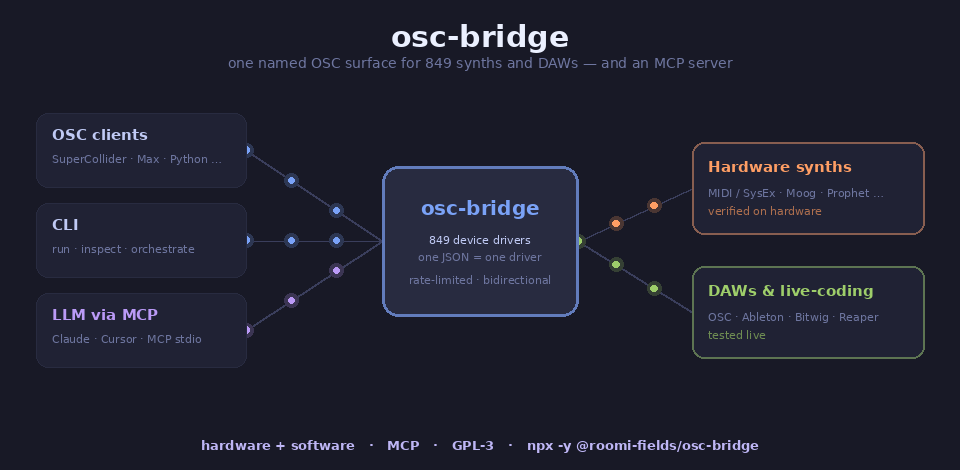

# osc-bridge

[](https://github.com/roomi-fields/osc-bridge/releases)
[](https://github.com/roomi-fields/osc-bridge/actions/workflows/ci.yml)
[](LICENSE)

**Declarative OSC bridge for music hardware *and* software — and an MCP server to drive it from an LLM.**

971 hardware synthesizers over MIDI / SysEx, plus DAWs and live-coding
environments over OSC (Ableton, Bitwig, Reaper, Sonic Pi, SuperCollider, Pure
Data, TouchDesigner, VCV Rack). Every device gets a clean, named OSC surface
described by one JSON file. Drive it from a live-coding client, a DAW, a
script, the CLI — or from Claude via the built-in **MCP server** (a **MIDI MCP**
*and* **OSC MCP**).



## Install

**Hosted MCP server, nothing to install** — the SynthHub server, run by the
maintainer of osc-bridge, with the up-to-date catalogue, trust from real use
and the relay to your own hardware:

- **Claude** (web, desktop): Settings → Connectors → *Add custom connector* →
  `https://mcp.synthhub.roomi-fields.com/mcp`
- **Claude Code**: `claude mcp add --transport http synthhub https://mcp.synthhub.roomi-fields.com/mcp`
- **Cursor and other clients**: `{"mcpServers": {"synthhub": {"url": "https://mcp.synthhub.roomi-fields.com/mcp"}}}`

**On your machine** — the MCP server over stdio, with hardware detection and
OSC to a running bridge (kept up to date from the server; you choose what it
shares):

```bash
npx -y @roomi-fields/osc-bridge mcp
```

As a **standalone bridge / CLI**:

```bash
npm install -g @roomi-fields/osc-bridge      # downloads the prebuilt binary
# or grab a binary directly from the Releases page
osc-bridge run --device devices/arturia/minilab3.json --out-port 4
```

MCP client config and the tools → [`docs/MCP.md`](docs/MCP.md). Full
quick-start with MIDI port discovery → [§ Install & quick start](#install--quick-start).

## Why a bridge?

Modern synths — hardware and software alike — expose themselves over MIDI,
SysEx, and OSC with proprietary, scattered protocols. Using them from
live-coding environments, a DAW, a script, or an LLM is painful:

- CC / NRPN addresses are cryptic
- SysEx byte formats are hand-rolled per device
- Bidirectional state (what the device CURRENTLY knows) is hard to track

**`osc-bridge`** gives every supported synth a clean, named OSC surface:

```supercollider
~mb = NetAddr("127.0.0.1", 7777);
~mb.sendMsg("/minilab3/knob/3/cc_number", 64);     // reconfigure knob 3
~mb.sendMsg("/minilab3/pad/0/color", 127, 0, 0);    // pad 1 red
~mb.sendMsg("/minilab3/display/text", "Hello", "World");
```

Each synth is described by one JSON file. No Rust recompile required to add a device.

## What makes it different

- **One JSON = one driver.** Adding a synth is ~30 lines of declarative JSON — CC numbers, SysEx frame templates, optional parameter tables. No Rust, no bindings, no build step. Ship a PR, `osc-bridge run` picks it up.
- **971 devices out of the box.** Every Prophet, every Oberheim, every Yamaha DX-family, MatrixBrute, Hydrasynth, Virus TI, Digitone, Matrix-1000… most of the catalogue is usable today. Fully searchable at [synthhub.roomi-fields.com](https://synthhub.roomi-fields.com/).
- **Hardware *and* software.** The same named OSC surface drives a hardware synth over MIDI/SysEx *or* a DAW / live-coding environment over OSC — Ableton, Bitwig, Reaper, Sonic Pi, SuperCollider, Pure Data, TouchDesigner, VCV Rack. See [§ Software targets](#software-targets--daws-and-live-coding-environments).
- **An MCP server built in.** `osc-bridge mcp` exposes the whole catalogue to Claude (or any MCP client) — a MIDI MCP *and* OSC MCP. Discover devices, read a device's OSC surface, send OSC to synths and DAWs. See [`docs/MCP.md`](docs/MCP.md).
- **Honest provenance.** Each device declares its source in `_sources[]`: `✅ hardware-verified`, `✅ software-verified`, `📘 vendor-doc`, `📡 vendor-osc-api` / `📡 third-party-osc`, `🎛️ electra-preset`, `📦 pencilresearch`. You always know whether a mapping was tested on the device or lifted from a spec sheet.
- **Bidirectional out of the box.** Incoming MIDI (knob turns, SysEx replies, NRPN) is decoded and re-emitted as OSC. Multi-client fan-out is a `--osc-client` flag.
- **N-to-N orchestration.** One process can drive several synths at once (`osc-bridge orchestrate --config bridge.toml`), each reachable under its own OSC prefix — so two MatrixBrutes live side-by-side as `/matrixbrute-1` and `/matrixbrute-2`.
- **First-class reconfigurable controllers (Electra One MK2).** Upload a generated preset as one OSC call; the bridge parses the JSON, reconfigures the device over SysEx, and *dynamically* rewires its own CC↔OSC routing so each knob on the new layout is reachable by name. Self-describing over OSC: `/bridge/docs` returns the integration guide, `/electra1/routes/list` returns the authoritative address table, so clients (or LLM-driven integrators) never hardcode slugification or protocol details. See [§ Reconfigurable controllers](#reconfigurable-controllers-electra-one-mk2--the-scripts-stress-test) below.
- **Escape hatch when JSON isn't enough.** For devices with checksums, quirky scaling, or stateful protocols, an optional per-parameter `transform` / per-command `script` runs Lua 5.4 sandboxed (1 MiB / 10 ms caps, no `os`/`io`/loaders). Used sparingly — `osc-bridge lint` warns on every script use — but it lets the declarative core stay small without giving up on edge cases. See [`docs/scripting.md`](docs/scripting.md).
- **Runtime you can trust.** Rate-limiting per device, backpressure-aware, zero-alloc hot path, no GC. Single static binary on Windows / Linux / macOS.

## Supported devices

**971 devices across 216 vendors** (1139 driver files) — Moog · Arturia · Novation · Korg · Sequential · Dave Smith Instruments · Roland · Yamaha · Elektron · Waldorf · Behringer · Dreadbox · Erica Synths · Polyend · Modal · Expressive E · Bastl · Chase Bliss · Make Noise · Electra One · Tasty Chips · Oberheim · Access · ASM · Black Corporation · Hologram · Strymon · Empress · Meris · Eventide · Ensoniq · Rhodes · Haken · Tubbutec · **Ableton · Bitwig · Cockos (Reaper) · Sonic Pi · SuperCollider · Pure Data · TouchDesigner · VCV Rack** · and ~85 more.

| Status | Count | Highlight |
|---|---|---|
| ✅ **Verified** (tested on the physical device or against a running instance of the host software — scope varies per driver, see `_sources` in each JSON) | **5** | Arturia MiniLab 3 · Electra One MK2 · Ableton Push 3 · Arturia MatrixBrute (firmware-RE partial) · Ableton Live 12.2.7 (via AbletonOSC) |
| 📘 **Vendor-doc derived** (from manufacturer programmer's references — bytes match the spec) | **3** | Novation Launch Control XL 3 · Polyend Synth · … |
| 📡 **OSC-API (software targets)** — DAWs and live coding environments, declarative or passthrough | **7** | Bitwig Studio · Reaper · Sonic Pi · SuperCollider · Pure Data · TouchDesigner · VCV Rack |
| 🎛️ **Electra-preset derived** (from the [Electra One community preset library](https://app.electra.one/) — covers SysEx + CC/NRPN, author's editorial choices) | **588** | Prophet 5/10 · Prophet 6 · OB-6 · OB-X8 · Matriarch · Hydrasynth · Virus TI · Digitone · … |
| 📦 **MIDI Guide derived** (from [MIDI Guide](https://midi.guide) / [pencilresearch/midi](https://github.com/pencilresearch/midi), CC BY-SA 4.0 — CC/NRPN, plus 15 drum maps with named sounds) | **376** | Moog · Sequential · DSI · Roland · Yamaha · Waldorf · Behringer · Dreadbox · Elektron · … |
| 🚧 **WIP / 📝 stub** | **2** | GR Mega (placeholder) |

**Searching for your device?**
- 🔎 Interactive browser → **<https://synthhub.roomi-fields.com/>** (live search by vendor / model / author / source).
- 🤖 For scripts and AI agents → JSON API at <https://synthhub.roomi-fields.com/api/v1/index.json> (each driver at `/api/v1/devices/<vendor>/<driver>.json`), or the hosted MCP server at <https://mcp.synthhub.roomi-fields.com/mcp> — see [API for agents](https://synthhub.roomi-fields.com/api/).
- 📄 Full catalogue as Markdown → [`docs/SUPPORTED_DEVICES.md`](docs/SUPPORTED_DEVICES.md) (auto-generated, organised by vendor).

Your synth isn't there, or a doc-derived entry (`📘` / `📡` / `🎛️` / `📦`) needs promoting to `✅` after you test it on hardware? See the next section.

### Share your own device

New here? The [30-minute tutorial](docs/TUTORIAL_FIRST_DEVICE.md) builds a
working driver end to end. Otherwise — three common cases, pick yours:

**Your synth isn't listed** → open a PR adding `devices/<vendor>/<slug>.json`.
  1. Find a source: vendor programmer's reference, MIDI implementation PDF, or a canonical CSV. No source cited = PR stays open until one is provided.
  2. If it's in [pencilresearch/midi](https://github.com/pencilresearch/midi), run `python3 scripts/import_pencilresearch.py <path-to-csv>` — generates the JSON for you.
  3. Otherwise copy a similar existing device from `devices/` as a template and follow [`docs/DEVICE_JSON_SCHEMA.md`](docs/DEVICE_JSON_SCHEMA.md).
  4. Run `cargo run --release -- lint <file>` and `cargo test --release`.
  5. Run `python3 scripts/regen_supported_devices.py` to refresh the catalogue.
  6. Open the PR — GitHub shows the `new_device.md` template.

**Your synth is listed but not yet `✅`, and you have the hardware** → PR promoting it to `✅`. Test every route, attach the log, flip the marker. `promote_to_verified.md` template.

**Your synth is listed but a CC is wrong / needs SysEx added** → PR updating the JSON. `update_device.md` template. Especially welcome on pencilresearch-imported devices where SysEx needs to be layered in.

Full contributor guide (schema extensions, bug reports, Lua escape hatch) → [`CONTRIBUTING.md`](CONTRIBUTING.md). For devices whose protocol can't be expressed declaratively, see [`docs/scripting.md`](docs/scripting.md) — use sparingly; `osc-bridge lint` warns on every use.

## Reconfigurable controllers (Electra One MK2) — the scripts stress-test

Most synths have a fixed set of controls — MiniLab 3's knobs always mean the same
thing. The [Electra One MK2](https://electra.one/) is different: its 216 controls
are defined by a preset that you upload to the device, and the meaning of every
CC changes when the preset changes. A static JSON spec can't describe that; the
bridge treats it as a first-class case.

**This integration is what validates the whole Lua scripting subsystem in anger.**
The MK2 driver exercises every feature of the `scripting.rs` layer on real
hardware (firmware 4.1.4, verified 2026-04-14):

- **Native JSON codec** (`ob.json_decode` / `ob.json_encode`) — parses a full
  Electra preset (up to 100 KB of nested pages/devices/groups/controls/overlays)
  in a single Lua block, under the 500 ms `preset_ingest` profile.
- **Persistent per-device state** (`ob.state`) — the driver stores the active
  preset name so `/electra1/preset/current` can report it on demand.
- **Dynamic CC↔OSC route registration** (`ob.register_cc_route` /
  `ob.clear_routes` / `ob.set_current_page`) — every preset upload rebuilds
  the bridge's routing table from scratch, zero restart.
- **Multi-block SysEx emission** (`ob.emit_sysex`) — the upload script emits
  the wrapped SysEx preset data block directly from Lua.
- **Outbound OSC emission** (`ob.emit_osc`) — powers the introspection
  endpoints: `/routes/list`, `/preset/current`, `/page/current`.
- **Reply scripts with matched bindings** (`ctx.bindings`) — when the device
  reports a page switch over SysEx, a reply script updates the bridge's active
  page so CC routing tracks the hardware UI automatically.
- **Companion markdown auto-load** — `devices/electra-one/electra-one.md` is
  loaded at startup and served over `/bridge/docs`, so LLM-driven integrators
  read the device-specific quirks (hex-color requirement, `inputs[{potId}]`
  mandatory, envelope-segment cycling gesture, MIDI port selection, etc.)
  without any code-side knowledge.

Every item above has a unit test, an end-to-end test against the real `.json`
driver, and a hardware-verified green light. If you're building a driver for
another reconfigurable controller (Faderfox custom, programmable MIDI Fighter),
the Electra driver is the template — copy its `custom_commands` block, adapt
the JSON→routes parsing to your device's preset format, done.

### What the bridge does

```
 Kanopi / your client                   osc-bridge                     Electra One MK2
─────────────────────                 ────────────────               ────────────────────

 /electra1/preset/upload  ───► parse preset JSON (preset_ingest
   "<preset JSON>"                profile: 500 ms / 4 MiB Lua)
                                ┌─ ob.clear_routes()
                                ├─ ob.register_cc_route × N
                                │    (one per cc7 control,
                                │     per-page, with channel)
                                └─ ob.emit_sysex(…)  ──────────► F0 00 21 45 01 01 <json> F7
                                                                          (reconfigures device)
                                                   ◄────────── F0 00 21 45 7E 01 …  ACK

 (user turns knob on page 2)                     ◄────────── B4 4A 53  (CC#74 ch5 = 83)
                             route lookup: page=2, ch=4, cc=74
                             → /electra1/page2/cutoff 0.65 ───► /electra1/page2/cutoff 0.65

 (user switches page on device)                  ◄────────── F0 00 21 45 7E 06 03 F7
                             reply.script fires:
                             ob.set_current_page(3)
                                                               ───► /electra1/page/switched 3
```

### Discovery from zero

Every piece of device-specific knowledge is exposed over OSC — clients never
hardcode slugification rules, page indexing, or SysEx opcodes:

| Send | Receive |
|---|---|
| `/bridge/status` | One `/bridge/status/device <slug> <status>` per connected device |
| `/bridge/docs` | `/bridge/docs/device <slug> <markdown>` — full integration guide (the device's companion `.md`, loaded automatically) |
| `/electra1/routes/list` | N× `/electra1/routes/entry <addr> <ch> <cc> <page> <min> <max>` then `/electra1/routes/done` |
| `/electra1/preset/current` | `/electra1/preset/current <name>` |
| `/electra1/page/current` | `/electra1/page/current <n>` |

An LLM-driven integrator needs exactly four steps to go from cold start to
routing knob turns: `/bridge/status` → `/bridge/docs` → `/electra1/preset/upload`
→ `/electra1/routes/list`. Everything else is in the markdown guide embedded
in the bridge itself.

### Generalising to other reconfigurable controllers

The machinery (`DynamicRoutes`, `ob.register_cc_route`, `ob.emit_sysex`,
`custom_commands`, companion `.md` auto-loading) is device-agnostic. Adding
a reconfigurable Faderfox, a custom MIDI Fighter Twister layout, or any
programmable controller is the same recipe: a preset-parsing Lua block inside
the device JSON that calls `ob.register_cc_route` per control. No core changes.

## Install & quick start

### Prebuilt binaries
Grab the latest `osc-bridge.exe` (Windows), `osc-bridge` (Linux/macOS) from
the [Releases page](https://github.com/roomi-fields/osc-bridge/releases).

### From source
```
git clone https://github.com/roomi-fields/osc-bridge
cd osc-bridge
cargo build --release
./target/release/osc-bridge list
```

### Minimal MiniLab 3 workflow

```bash
# 1. Find your synth, its driver and its MIDI ports
osc-bridge detect

# 2. Start the bridge
osc-bridge run --device devices/arturia/minilab3.json \
  --out-port 4 --in-port 0 \
  --bind 127.0.0.1:7777 --osc-client 127.0.0.1:8888

# 3. From another terminal, send OSC
osc-bridge osc-send /minilab3/display/text "Hello" "World"
osc-bridge osc-send /minilab3/pad/0/color 127 0 0
osc-bridge osc-send /minilab3/knob/3/cc_number 100
```

Incoming MIDI events (knob turns, pads played, pitch-bend, SysEx GET replies)
are forwarded to `--osc-client` as OSC:

```
/minilab3/cc/18 95 0        ← knob moved
/minilab3/note/on 60 127 0
/minilab3/param/value 0 7 0 0 1   ← reply from a /param/get
```

### Browser clients (OSC over WebSocket)

Browsers can't speak UDP. Pass `--ws-bind` to expose the same OSC surface
over WebSocket:

```bash
osc-bridge run --device devices/arturia/minilab3.json \
  --out-port 4 --in-port 0 --ws-bind 127.0.0.1:7890
```

Binary WS frames carry raw OSC packets — the exact bytes the UDP transport
uses, so a minimal dependency-free OSC encoder/decoder in JS covers both
directions. Every connected WS client behaves like an extra `--osc-client`:
it receives all outbound events (decoded MIDI-in, SysEx replies,
`/bridge/status`) and its frames go through the same dispatch as UDP.
Under `orchestrate`, set `ws_bind = "127.0.0.1:7890"` in the `[osc]`
section of `bridge.toml`. Disabled by default; keep it on `127.0.0.1`
unless you really want LAN clients.

Only pages served from this machine (`localhost`, `127.0.0.1`) and
non-browser clients may connect: any other website open in your browser is
refused (HTTP 403), so it cannot reach your synths. Allow a specific site
with `--ws-allow-origin https://example.org` (repeatable; `null` for
`file://` pages; `*` for any), or `ws_allow_origins = [...]` in
`bridge.toml`.

### Device not showing up? (Windows 11 24H2+)

Since the March 2026 cumulative update (KB5079473), Windows 11 ships
Microsoft's new `USBMidi2-ACX` driver which enforces stricter USB descriptor
checks. Devices that pass the old checks but fail the new ones appear in
Device Manager with **Status: Unknown**, or bind to a driver that exposes
them only through the new MIDI Services API — **invisible to `midir` (and
therefore to osc-bridge)** which queries the legacy MME interface.

Confirmed affected: **Polyend Synth / Play / Tracker / Mess / Step**
(VID 16D0). Likely affected: any older USB-MIDI device whose descriptor
doesn't meet the new spec.

Workaround — force the legacy `usbaudio` driver:

1. Device Manager → **Sound, video and game controllers** → right-click the
   device → **Update Driver**.
2. **Browse my computer for drivers** → **Let me pick from a list of
   available drivers on my computer**.
3. Select **USB Audio Device** (FR: "Périphérique audio USB"). If not
   visible, uncheck "Show compatible hardware" and look under the Standard
   USB section.
4. Install, then unplug/replug the USB cable to force MME to re-enumerate.
5. `osc-bridge list` should now show the device.

Track Microsoft's progress on KB5079473 if you want a permanent fix —
Pete Brown (Microsoft) acknowledged the packet-size issue publicly but
classified it as non-blocking. Polyend's firmware-side fix is not
announced at the time of writing.

## Ergonomics

### Which synth is plugged in, and which driver fits?
```
osc-bridge detect
```
Lists MIDI ports, asks each device who it is (the standard MIDI Identity
Request — harmless), matches the catalogue and prints a ready-to-run
`osc-bridge run` line. `--no-probe` matches by port name only.

### Back up and restore presets (SysEx librarian)
```
osc-bridge backup  --in-port minilab --out backups/minilab3.syx   # then start the dump on the device
osc-bridge restore --out-port minilab backups/minilab3.syx        # overwrites the device's memory
```
Ports take an index or a name fragment. `backup --request "F0 … F7" --out-port …`
sends a dump request first; `restore --gap-ms` paces older devices.

### Drum machines: play sounds by name
Drivers with a drum map expose each voice: `/drm1_mkiv/drum/kick 110` fires
the Vermona DRM1 MKIV kick at velocity 110 (note 36, channel 10). When a
device documents several trigger modes, the address carries the mode, e.g.
`/tr_8s/drum/default_note_map/bass_drum`. See
[`DEVICE_JSON_SCHEMA.md`](docs/DEVICE_JSON_SCHEMA.md#triggers--named-drum-sounds-osc--midi-note).

### Explore a device spec without connecting anything
```
osc-bridge inspect devices/arturia/minilab3.json
```

### Live-debug the OSC traffic
```
osc-bridge osc-listen --bind 127.0.0.1:8888
```

### Send raw SysEx (power user)
```
osc-bridge osc-send /minilab3/raw/syx "F0 00 20 6B 7F 42 02 00 16 04 7F 00 00 F7"
```

## How device JSONs work

A device file declares three things:

1. **Framing** — the SysEx header/footer bytes.
2. **Commands** — high-level OSC routes (pad colors, display text, preset recall) that build frames by substituting OSC args into placeholder templates.
3. **Params** — a flat table of parameter addresses for bulk GET/SET via a shared opcode.

Example snippet (`devices/arturia/minilab3.json`):

```jsonc
{
  "commands": [
    {
      "osc": "/pad/{pad}/color",
      "args": [
        {"name":"pad","type":"u7","range":[0,7]},
        {"name":"r","type":"u7"},
        {"name":"g","type":"u7"},
        {"name":"b","type":"u7"},
        {"name":"mode","type":"enum",
         "values":{"user":0,"arturia":1,"daw":2},"default":"user"}
      ],
      "pre": [{"bind":"pad_id","expr":"pad + 4"}],
      "frame": [2, "{mode}", 22, "{pad_id}", "{r}", "{g}", "{b}"]
    }
  ],
  "params": {
    "get_frame": [32, "{pr}", "{p}", "{c}", "{r}"],
    "set_frame": [33, "{pr}", "{p}", "{c}", "{r}", "{val}"],
    "value_type": "u7",
    "entries": [
      {"osc":"/global/backlight", "pr":7, "p":0, "c":0, "r":0, "range":[0,1]}
    ]
  }
}
```

## Software targets — DAWs and live coding environments

osc-bridge isn't only for hardware synthesizers. Since version 0.10 it also
treats DAWs and live-coding environments as **first-class devices**, behind
the same `/<env>` OSC surface as a Prophet or a Matriarch. A driver JSON
declares `device.transport.kind = "osc"` and the bridge forwards OSC to the
target's UDP port instead of going through a MIDI cable.

Two flavors:

**Declarative drivers** — when the host software has a fixed, documented OSC
surface (Ableton via [AbletonOSC](https://github.com/ideoforms/AbletonOSC),
Bitwig via [DrivenByMoss](https://github.com/git-moss/DrivenByMoss), Reaper's
native OSC). The driver enumerates `commands[]` with typed args, plus
`replies[]` for incoming events.

**Passthrough drivers** — when the host software has no fixed OSC surface and
each user defines their own paths in their project (Sonic Pi, SuperCollider,
Pure Data, TouchDesigner, VCV Rack). The driver just declares
`transport.passthrough_prefix` and the bridge forwards anything under
`/<env>/...` verbatim. Replies travel the other way with the prefix added back.

Currently supported:

| Target | Mode | Status |
|---|---|---|
| Ableton Live 12.2.7 + AbletonOSC | declarative | ✅ software-verified |
| Bitwig Studio + DrivenByMoss | declarative | 📡 third-party-osc |
| Reaper 7 (Default.ReaperOSC) | declarative | 📡 vendor-osc-api |
| Sonic Pi 4.5 | passthrough | 📡 vendor-osc-api |
| SuperCollider sclang 3.13 | passthrough | 📡 vendor-osc-api |
| Pure Data 0.55-x | passthrough | 📡 vendor-osc-api |
| TouchDesigner 2023 | passthrough | 📡 vendor-osc-api |
| VCV Rack 2 + [vcv-osc](https://github.com/roomi-fields/vcv-osc) plugin | passthrough | 📡 third-party-osc |

Each comes with a `.md` companion under `devices/<vendor>/` that documents the
required setup on the host side (Remote Script installation, ports, conventions).

Combined with `osc-bridge orchestrate`, you can drive a hardware MiniLab 3,
an Ableton Live, and a Sonic Pi loop **from a single process**. With the
new `[[routes]]` section in `bridge.toml`, a knob turn on the MiniLab can
drive an Ableton track volume or a Sonic Pi cue, without writing any client
code:

```toml
[osc]
bind = "127.0.0.1:7777"
clients = ["127.0.0.1:8888"]
# ws_bind = "127.0.0.1:7890"   # optional — browser clients over WebSocket

[[devices]]
spec = "devices/arturia/minilab3.json"
midi_out_port = 4
midi_in_port = 0

[[devices]]
spec = "devices/ableton/live.third-party-osc.fw-12.2.json"   # AbletonOSC: no MIDI port needed

[[routes]]
from = "/minilab3/cc/74"
to = "/ableton/track/0/volume"
map.from = [0, 127]
map.to = [0, 1]
```

## Use from Claude via MCP

osc-bridge ships a [Model Context Protocol](https://modelcontextprotocol.io)
server — a **MIDI MCP** *and* **OSC MCP**. Point any MCP client at it and the
model can browse the 971-device catalogue, read a device's OSC surface, and
send OSC to synths and DAWs.

**Hosted** — add `https://mcp.synthhub.roomi-fields.com/mcp` as a remote MCP server (see
[Install](#install)). Nothing to install; your synth joins through the relay
page, [synthhub.roomi-fields.com/connect](https://synthhub.roomi-fields.com/connect/).

**On your machine**:

```jsonc
{
  "mcpServers": {
    "osc-bridge": {
      "command": "npx",
      "args": ["-y", "@roomi-fields/osc-bridge", "mcp"]
    }
  }
}
```

Eight local tools — `list_devices`, `get_device_docs`, `list_routes`, `send`,
`get_status`, `detect_hardware`, `backup_presets`, `restore_presets` — plus
the server's: reports, trust, contributions and shared presets (find, load, take from the synth,
share). Then in conversation:
*"What can the MatrixBrute do? Sweep its filter cutoff."* — the model calls
`list_routes("matrixbrute")`, then `send`. No glue code.

Full setup — Claude Desktop / Cursor config, the workflow, driving software
targets → **[`docs/MCP.md`](docs/MCP.md)**.

## Project genesis

Started as a MatrixBrute OSC driver (patch format reverse-engineered from the
GPL-3 [sysex-controls](https://github.com/soyersoyer/sysex-controls) and the
community MBPV tool). Grew into a generic declarative bridge once the Arturia
protocol family became clear.

## License

AGPL-3.0-or-later. Running a modified version as a network service obliges
you to offer its source to the users of that service. The `sysex-controls`
reverse engineering that seeded our MiniLab 3 parameter table is GPL-3.0,
which GPL-3.0 section 13 allows to combine with AGPL-3.0 code.

### Third-party device data

Drivers whose `_sources[]` entry has `"type": "pencilresearch"` are adapted
from [MIDI Guide](https://midi.guide) by Pencil Research and contributors,
licensed [CC BY-SA 4.0](https://creativecommons.org/licenses/by-sa/4.0/)
(source: [pencilresearch/midi](https://github.com/pencilresearch/midi)). Each
of those entries records the licence, the attribution and the exact upstream
CSV and commit. Changes made here: CSV rows converted to the osc-bridge JSON
schema (OSC paths, ranges, `expects` hints, named note triggers).
CC BY-SA 4.0 is one-way compatible with GPL-3.0, under which these adapted
files are distributed (AGPL-3.0 section 13 covers their combination with the
code).
