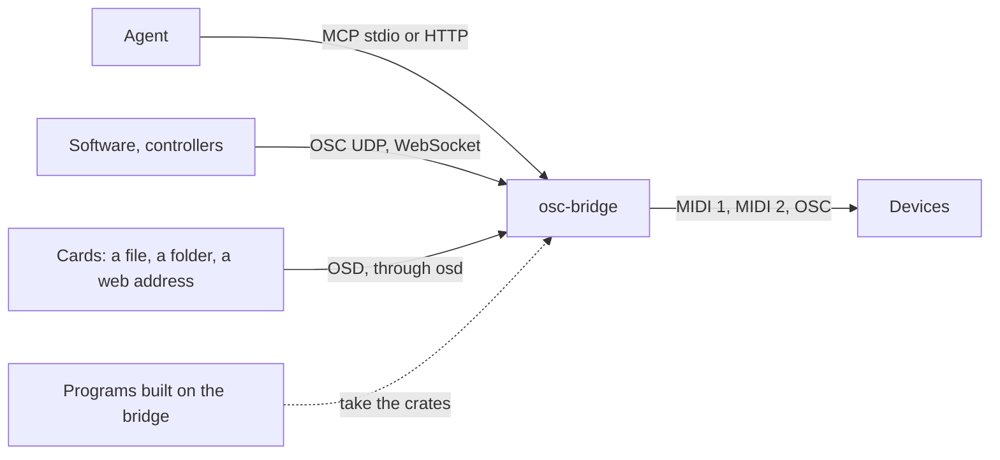
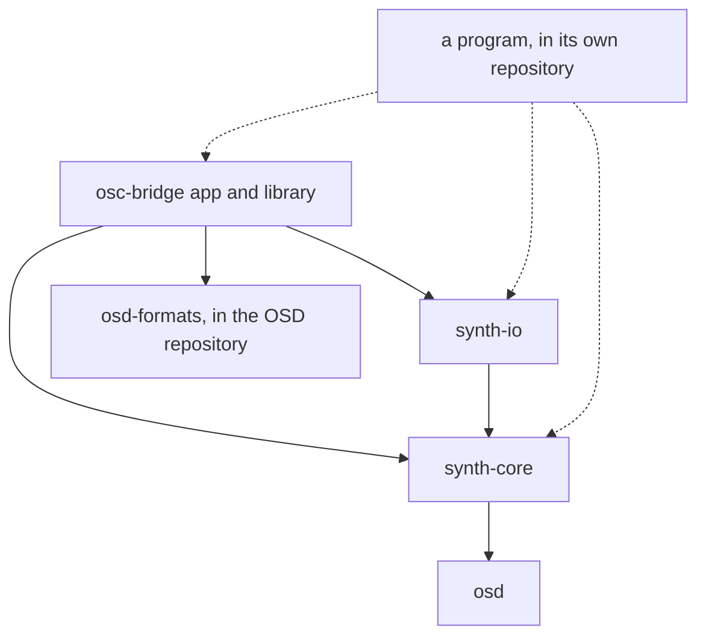
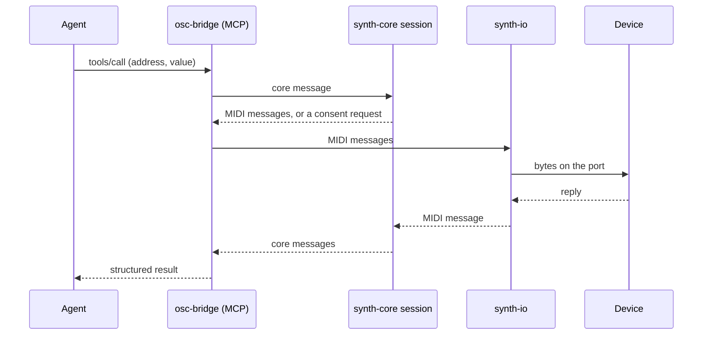
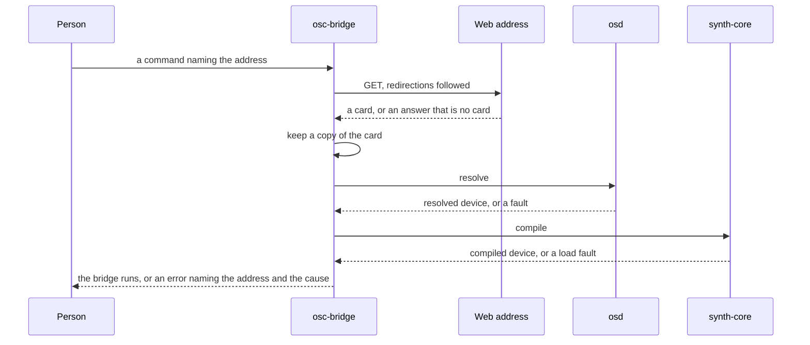

# osc-bridge — architecture

osc-bridge is an OSC bridge: it lets an agent or a piece of software drive a music device, by translating between OSC messages and the device's MIDI or OSC. Its core translates, one session per device, without touching ports or networks; its transports carry the messages to the wire; its application serves the command line, the MCP server of the local tools and the orchestrator. A device is described by a **card**: one file in the OSD format, read through the `osd` reader, that the person gives. This document describes the target construction of the workspace; the current code (one crate, `crates/osc-bridge/src/`) reaches it by the internal split of section 9, then by the core epic.

## 1. Context

What crosses the workspace's edges:

- **cards**, from a file, a folder of files, or a web address that returns a card, each given by the person or by the program that calls the bridge;
- **messages** from agents and software (MCP calls, OSC) and **MIDI or OSC** to and from devices;
- **the crates** `synth-core`, `synth-io` and the library of `crates/osc-bridge`, which another repository takes at a git tag. Translating between OSD and other formats (MIDNAM, OSCQuery, Electra One, the pencilresearch/midi CSV) is `osd-formats`, in the OSD repository, which the application calls.

Each crate's role and refusals live in its `CADRE.md`, what crosses its edges in its `INTERFACE.md`.

## 2. Strategy

1. **The core performs no I/O.** `synth-core` turns messages into MIDI or OSC messages and back, keeps a session per device (script state, dynamic routes), and returns its faults; ports, sockets and clocks are given to it. Reason: the same core runs in this application, in the programs built on it and in a browser, as `quinn-proto` runs under any transport.
2. **A device is compiled once.** A resolved card becomes a compiled device whose value encodings, checksums and address templates are parsed when it loads; a template naming an unknown capture is a load fault. Reason: no step re-parses strings while playing, a card that cannot be read is refused at load, and a part that cannot be built is reported at load and refused when used, never in silence mid-performance.
3. **The wire is a transport.** MIDI 1, MIDI 2 (UMP) and OSC are adapters of `synth-io` around the same core messages. Reason: a device's description says what it understands, not how the cable carries it.
4. **The bridge reads a card from the place it is given.** A card is named by a path or by a web address, and the caller chooses it; what orders two cards of the same device, each from its own place, is a value the caller gives, and two cards of one folder that claim the same device are an error that names both. Reason: the bridge works with any source of OSD cards, and a program that keeps a catalogue hands the bridge a path or an address, as `quinn-proto` receives its congestion controller from its caller.
5. **A program builds on the bridge.** The dependency goes one way: a program takes the crates of this workspace, envelops the MCP server (it answers its own tools and hands every other request to the bridge), and adds its commands beside the bridge's. Reason: the bridge is complete alone, and each program adds its service without changing it, as `quinn` depends on `quinn-proto`.

## 3. Components

| Crate | Responsibility | Owns | Calls | Language |
|---|---|---|---|---|
| `synth-core` | the session of a device: messages ↔ MIDI or OSC messages, replies, recognition (the request a card names and the reading of the reply), programs, the Lua capability, a virtual device that answers | the compiled device, the session state | `osd` | |
| `synth-io` | carry core messages: MIDI 1 ports, MIDI 2, OSC over UDP, WebSocket, OSCQuery, output pacing | ports, sockets | `synth-core` (types) | |
| `crates/osc-bridge` | the application and its library: the command line, the MCP server of the 16 local tools (stdio, HTTP with a token), the orchestrator of several devices with routes between them, the reading of a card from a file, a folder or a web address, the recognition of the plugged devices against the cards given, the dump and restore of sounds, and the putting of an export on a plugged device through its own MIDI port type | the configuration the person gives (options, `bridge.toml`) | both, and `osd-formats` for writing a card in other formats | cargo |

The single-device mode is the orchestrator with one device: one dispatch path.

The workspace is the root `Cargo.toml`, a virtual workspace, as in rust-analyzer: the application is the crate `crates/osc-bridge` (it builds the `osc-bridge` binary and the `osc_bridge` library), and each crate under `crates/` is listed in its `members` once it has its own `Cargo.toml`. The members take their version, edition and licence from `[workspace.package]`, their lints from `[workspace.lints]` and their shared dependencies from `[workspace.dependencies]`; so the version that `scripts/sync_version.py` mirrors is the workspace's. `cargo build --release` builds the `osc-bridge` binary; `cargo test --workspace` and `cargo clippy --workspace --all-targets -- -D warnings` cover every member.

### 3.1 An illustration: the bridge used by SyntHub, its first client

This section illustrates the use of the bridge by a program, with SyntHub, its first and historical client: the program `synthub`, in its own repository, is built on the bridge. Each line says what the bridge does and what the program adds.

| Matter | The bridge | The program |
|---|---|---|
| where a card comes from | reads the file, the folder or the web address it is given, and keeps a copy of a card read from a web address | turns a catalogue id or a short name into a path or an address, keeps its cache, and orders the sources of a card |
| recognition | compares the ports, the USB ids and the identity replies with the cards given | adds the candidates of its service, listens to an unknown device (learn mode) and shares its fingerprint |
| agents | serves the 16 local tools | envelops that server and adds the tools of its service |
| sounds | dumps and restores by the card, puts an export on a device | takes a sound through its service's librarian |
| the person's devices from outside | serves OSC and MCP on the person's machine | opens the relay door, keeps the account and the privacy settings |
| contract with a service | exchanges OSC, MIDI, MCP and OSD only | holds `synthub-protocol` |

### 3.2 The guard of the frontier

Two checks hold the frontier, and a lot that breaks one is refused before main.

- **The graph of the crates.** No manifest of the workspace names a crate of a program or of a service; Cargo then refuses any import of one, as it refuses `quinn-proto` importing `quinn`.
- **The sources.** A test of `crates/osc-bridge` reads the code of the workspace and refuses the name or the host name of a service: every web address the bridge opens comes from the person. During the internal split (section 9) the same test refuses, in every module of the bridge, an import of the one module that holds the link to the service.

## 4. Data

| Data | Shape | Made by | Read by | Lifetime |
|---|---|---|---|---|
| card source | a path or a web address | the person, a program | the application | one load |
| copy of a web card | the card as the address returned it | the application | the application | on disk |
| resolved device | `osd` types | `osd::resolve` | `synth-core` | one load |
| compiled device | encodings, checksums and templates parsed | `synth-core` | the session | the session |
| session | script state, dynamic routes, pending replies | `synth-core` | the application, the programs built on the core | while the device is connected |
| core message | address and typed arguments, or a MIDI message | callers, `synth-io` | `synth-core` | one message |

Bytes stay bytes between crates; hexadecimal exists only at the edges a human or a client reads, written one way (upper case, spaced).

## 5. Flow

**An agent sets a parameter through the local MCP server.**

**The application loads a card from a web address.**

The card an address returns is complete: it names no parent, and `osd` resolves it alone. When the network does not answer, the application loads the copy it kept of that address.

## 6. Runtime

- The application runs on the person's machine or one they choose; the MCP server listens on stdio, or on HTTP with a token, local by default.
- With cards given as files or folders the application opens no connection to the network; a card named by a web address is read when it loads, and the application keeps a copy of it, from which it starts again without the network. That copy holds only the cards the person named by an address: it is no cache of a service, and it carries no catalogue id and no short name.
- A folder of cards is required to recognise the plugged devices and to serve agents: `detect` and `mcp` read the cards of the folder the person gives, and nothing else.
- `synth-core` and `osd` compile to `wasm32-unknown-unknown`; `synth-io` and the application are native.
- Output to a device is paced by `synth-io`; nothing on the playing path waits on the network.

## 7. Cross-cutting concepts

- **Safety**: every SysEx that may overwrite a device's memory is a consent request the caller must answer; only the identity request goes out without it.
- **Faults**: each crate returns typed faults; nothing is reported only on standard error. The faults of a message return to the one who sent it.
- **Capabilities**: a card that needs Lua declares it; the core runs scripts in a sandbox with time and memory budgets.

## 8. Quality

- **Live play**: a bench measures the core's delay from message to bytes; budget under 1 ms per message.
- **One test surface**: the session is tested through its interface with the shared cases (card, inputs, expected outputs), never by opening a module's inside.
- **Compatibility**: a published surface has one form; a valid card stays readable by later versions.
- **The frontier**: the guard of section 3.2 runs with the tests of `crates/osc-bridge`.

## 9. Risks

- The current code reaches this construction by steps. The internal split comes first: the link to the SyntHub service (its client, the relay door, the account, the privacy settings, the cache, the learn mode, the tools of the service) moves into one module of `crates/osc-bridge`, the dependencies that cross the frontier are inverted, and the behaviour of the binary stays the same; that module stays one module of the crate until the repository of the program is born, then leaves for it. `crates/osc-bridge/src/mcp.rs` and `crates/osc-bridge/src/runtime.rs` hold most of today's logic and split across the crates during the core epic.
- A repository that takes the library at a tag reads modules that leave with the link; it follows at the tag where they leave. The SyntHub service reads such modules, so the link leaves the bridge after the repository of the program is born.
- A card read from a web address is complete today; the address of a parent outside a folder waits for the OSD specification.
- MIDI 2 is carried by no device of the catalogue today; its transport opens when one needs it.
- The Lua budgets are measured per frame; a device whose scripts exceed them in live play is not yet observed.
