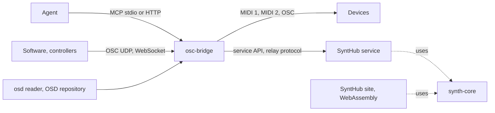
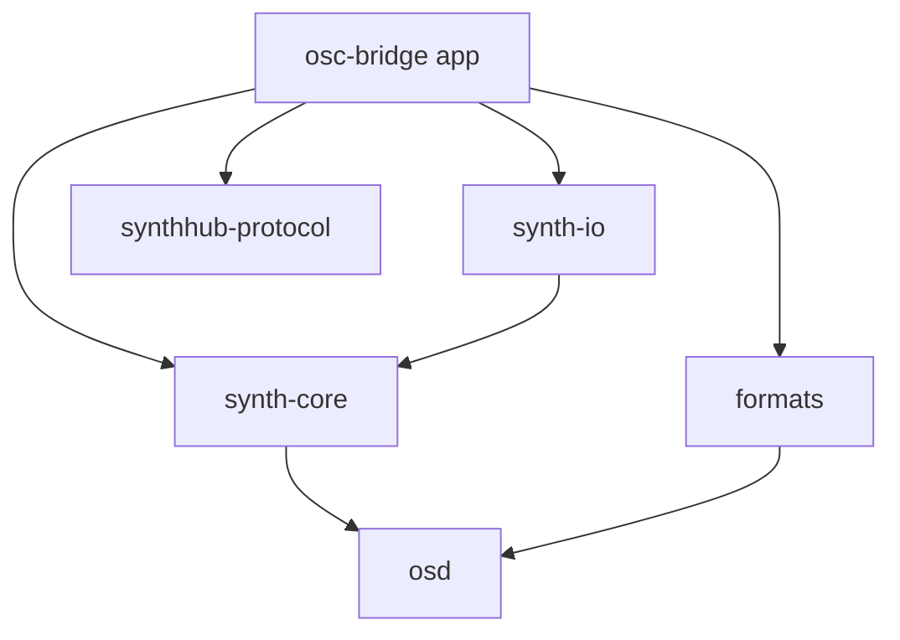
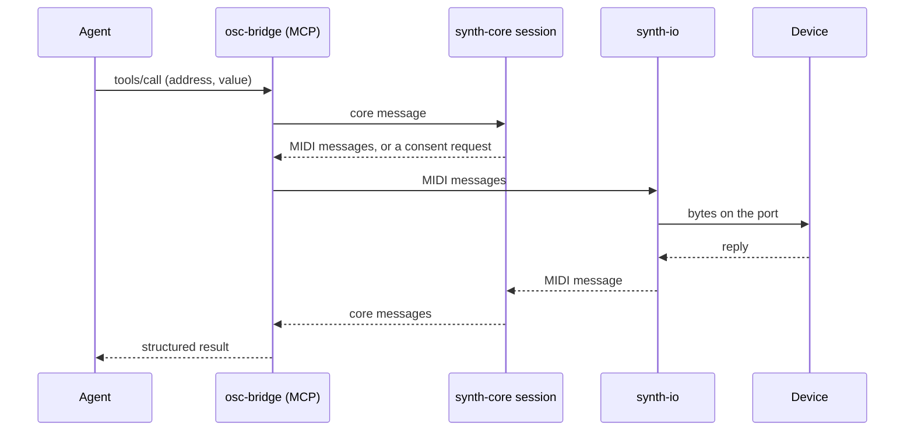

# osc-bridge — architecture

osc-bridge is the engine that lets an agent or a piece of software drive a music device. Its core translates between messages and a device's MIDI or OSC, one session per device, without touching ports or networks; its transports carry those messages to the wire; its application serves the CLI, the MCP server and the relay door. This document describes the target construction of the workspace; the current code (one crate, `src/`) reaches it through the core epic, after the format epic gives it the `osd` reader.

## 1. Context

What crosses the workspace's edges:

- **driver files** in the OSD format, read through `osd`, from the service or a local folder;
- **messages** from agents and software (MCP calls, OSC) and **MIDI or OSC** to and from devices;
- **the service API and the relay protocol**, typed by `synthhub-protocol`, shared with the service and the browser;
- **the crates** `synth-core`, `synth-io`, `formats` and `synthhub-protocol`, used by the service and the site.

Each crate's role and refusals live in its `CADRE.md`, what crosses its edges in its `INTERFACE.md`.

## 2. Strategy

1. **The core performs no I/O.** `synth-core` turns messages into MIDI or OSC messages and back, keeps a session per device (script state, dynamic routes), and returns its faults; ports, sockets and clocks are given to it. Reason: the same core runs in this application, on the service, in the browser, in virtual devices and plugins, as `quinn-proto` runs under any transport.
2. **A device is compiled once.** A resolved descriptor becomes a compiled device whose value encodings, checksums and address templates are parsed when it loads; a template naming an unknown capture is a load fault. Reason: no step re-parses strings while playing, and a faulty driver fails at load, not mid-performance.
3. **The wire is a transport.** MIDI 1, MIDI 2 (UMP) and OSC are adapters of `synth-io` around the same core messages. Reason: a device's description says what it understands, not how the cable carries it.
4. **One contract with the service.** The service API, the relay protocol and the installation's identity are the types of `synthhub-protocol`, used on both sides. Reason: an installed copy keeps working with the service, and no side re-writes the other's contract.

## 3. Components

| Crate | Responsibility | Owns | Calls |
|---|---|---|---|
| `synth-core` | the session of a device: messages ↔ MIDI or OSC messages, replies, recognition, programs, the Lua capability, a virtual device that answers | the compiled device, the session state | `osd` |
| `synth-io` | carry core messages: MIDI 1 ports, MIDI 2, OSC over UDP, WebSocket, OSCQuery, output pacing | ports, sockets | `synth-core` (types) |
| `formats` | export to and import from other formats: MIDNAM, OSCQuery, Electra One, Ctrlr | the converters | `osd` |
| `synthhub-protocol` | the types exchanged with the service: versioned API, relay frames, identity | the contract | nothing |
| `osc-bridge` (root) | the application: CLI, MCP server (stdio, HTTP with a token), orchestrator of several devices with routes between them, relay door, driver cache, privacy settings | the installation's configuration | all four |

The single-device mode is the orchestrator with one device: one dispatch path.

The workspace is the root `Cargo.toml`, as in ripgrep and uv: the application is its root package, and each crate under `crates/` is listed in its `members` once it has its own `Cargo.toml`. The members take their version, edition and licence from `[workspace.package]`, their lints from `[workspace.lints]` and their shared dependencies from `[workspace.dependencies]`; so the version that `scripts/sync_version.py` mirrors is the workspace's. `cargo build --release` builds the `osc-bridge` binary; `cargo test --workspace` and `cargo clippy --workspace --all-targets -- -D warnings` cover every member.

## 4. Data

| Data | Shape | Made by | Read by | Lifetime |
|---|---|---|---|---|
| resolved device | `osd` types | `osd::resolve` | `synth-core`, `formats` | one load |
| compiled device | encodings, checksums and templates parsed | `synth-core` | the session | the session |
| session | script state, dynamic routes, pending replies | `synth-core` | the application, the service, the browser | while the device is connected |
| core message | address and typed arguments, or a MIDI message | callers, `synth-io` | `synth-core` | one message |
| installation | its id issued by the service, its settings | the service, the application | the application | on disk, per installation |

Bytes stay bytes between crates; hexadecimal exists only at the edges a human or a client reads, written one way (upper case, spaced).

## 5. Flow

**An agent sets a parameter through the local MCP server.**

## 6. Runtime

- The application runs on the person's machine or one they choose; the MCP server listens on stdio, or on HTTP with a token, local by default; offline, it reads drivers from its cache.
- `synth-core` and `osd` compile to `wasm32-unknown-unknown`; `synth-io` and the application are native.
- Output to a device is paced by `synth-io`; nothing on the playing path waits on the network.

## 7. Cross-cutting concepts

- **Safety**: every SysEx that may overwrite a device's memory is a consent request the caller must answer; only the identity request goes out without it.
- **Faults**: each crate returns typed faults; nothing is reported only on standard error.
- **Identity**: an installation keeps the id the service issued, linked to its person once they sign in; each call to the service carries the client's version.
- **Capabilities**: a driver that needs Lua declares it; the core runs scripts in a sandbox with time and memory budgets.

## 8. Quality

- **Live play**: a bench measures the core's delay from message to bytes; budget under 1 ms per message.
- **One test surface**: the session is tested through its interface with the shared cases (driver, inputs, expected outputs), never by opening a module's inside.
- **Compatibility**: requests recorded from published clients replay against the service's types.

## 9. Risks

- The current code reaches this construction by steps: `src/mcp.rs` and `src/runtime.rs` hold most of today's logic and split across the crates during the core epic.
- MIDI 2 is carried by no device of the catalogue today; its transport opens when one needs it.
- The Lua budgets are measured per frame; a device whose scripts exceed them in live play is not yet observed.
